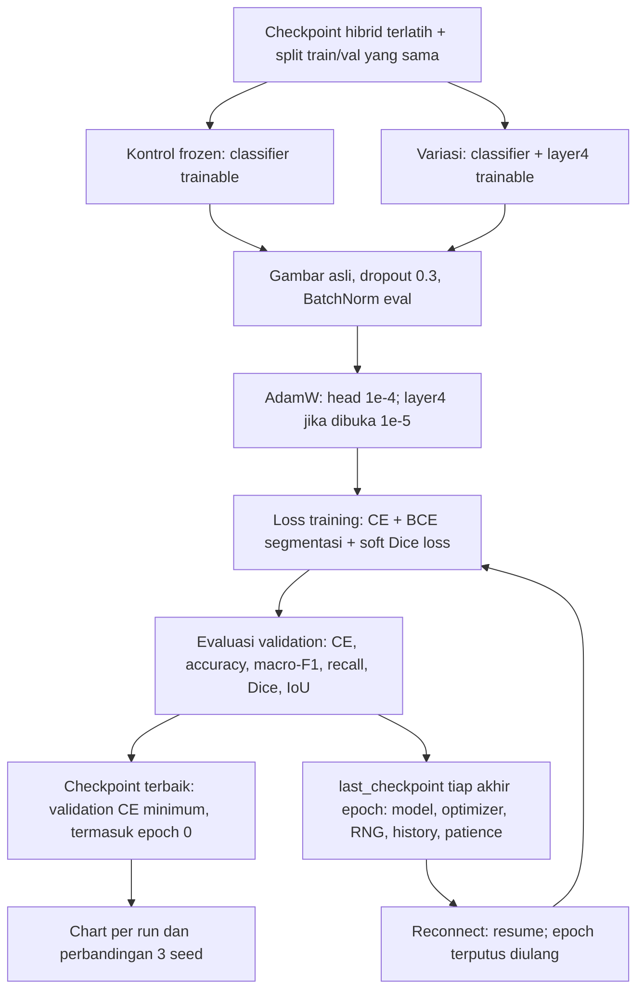

# Variasi tambahan fine-tuning layer4 (Step 28)

Eksperimen ini **bukan pengganti metode utama proposal**. Tetap menggunakan
arsitektur hibrid checkpoint, tetapi menguji adaptasi classifier dan blok terakhir
encoder. AdamW, CE, tanpa MA-LDS/morphology consistency loss/weighted sampler
adalah perbedaan protokol yang harus dilaporkan, bukan diklaim sebagai metode
proposal yang identik. Tiga seed tidak menggantikan 5-fold CV.

## Ilustrasi alur (bukan chart hasil)



Frozen decoder/fusion tetap dilewati dalam forward; pada variasi layer4,
gradien dapat melewatinya ke layer4 meskipun parameternya tidak diperbarui.
Loss segmentasi membantu mempertahankan segmentasi, tetapi tidak menjamin
Dice/IoU tidak menurun. Tidak ada akses gambar/mask test di Step 28.

## Chart hasil aktual

Cell kedua Step 28 memanggil `scripts/plot_layer4_results.py`.
Tidak perlu melatih ulang untuk membuat chart; hanya `metrics.json` yang dibaca.
Jika tidak ada hasil, tidak dibuat data simulasi.

Per run, di `FT_ROOT/<mode>_seed<seed>/charts/`:

- `learning_curves.png`: empat panel train total loss, validation classification
  CE, validation accuracy/macro-F1, dan validation Dice/IoU. Train total loss
  dan validation CE **berbeda objektif**, jangan menafsirkan selisihnya sebagai
  generalization gap. Epoch 0 adalah checkpoint awal, garis putus-putus menunjuk
  checkpoint terbaik berdasarkan validation CE. Train accuracy tidak direka.
- `confusion_matrix_val.png`: jumlah dan proporsi per baris pada checkpoint
  terpilih; sumbu Y = kelas asli, sumbu X = prediksi. Baris tanpa support = 0.
- `recall_per_class.png`: recall validasi per kelas; tanpa support = 0.
- `training_history.csv`: history epoch tersimpan, tidak termasuk epoch 0.

Perbandingan, di `FT_ROOT/charts/`:

- `seed_comparison.png` dan `seed_summary.csv`: mean, sample SD (hanya n > 1),
  titik seed individual dan jumlah run completed untuk masing-masing mode.
  Jika jumlah/seed kedua mode belum sama, perbandingan ini masih belum lengkap.
- `paired_deltas.png` dan `paired_deltas.csv`: layer4 dikurangi frozen untuk
  seed yang kedua run-nya completed. Positif lebih baik untuk accuracy/F1/Dice/IoU;
  negatif lebih baik untuk CE. Delta accuracy 0,01 = 1 poin persentase.

Run parsial hanya masuk chart per-run, **tidak** mean/SD atau delta berpasangan.
Sample SD bukan confidence interval atau bukti signifikansi statistik.
Jangan memilih model berdasarkan accuracy saja jika segmentasi mengalami regresi.

```bash
python scripts/plot_layer4_results.py --root PATH/layer4_finetune_v1 --seeds 42 43 44
```

Memerlukan matplotlib; script plotting dan trainer perlu diunggah ke Colab atau
dipush ke GitHub sebelum diunduh otomatis oleh notebook. File chart yang dibuat
ulang ditimpa; checkpoint, metrics dan log training tidak diubah oleh plotter.

## Resume Colab

Simpan FT_ROOT di Google Drive. Setelah reconnect, mount Drive dan pulihkan
dependensi/variabel/path, gunakan konfigurasi identik dan FT_RESUME=True.
Checkpoint disimpan setiap akhir epoch, bukan setiap batch. Epoch yang belum
selesai diulang; run completed dilewati. Log ditambahkan, bukan ditimpa.
SHA-256 sumber dan konfigurasi diperiksa. Isi gambar/mask tidak di-hash dan harus
tetap sama; bit-identik lintas perangkat/versi library tidak dijamin.
