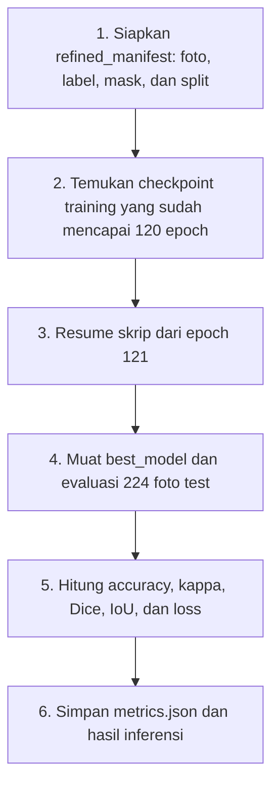
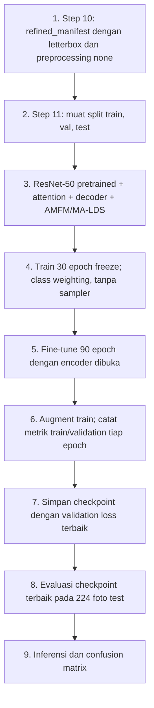
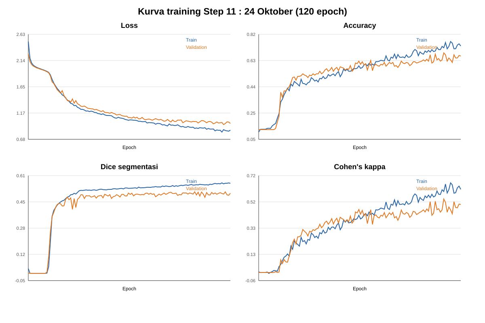
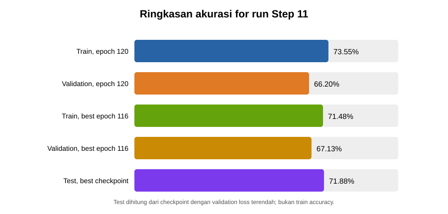
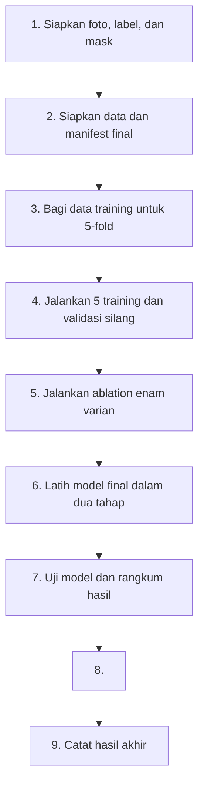

# Catatan Perjalanan Penelitian Jerawat

**Bahan konsultasi dengan dosen pembimbing**  
**Urutan cerita:** 12 Oktober → 24 Oktober → 25 Oktober

Penelitian ini memakai foto wajah untuk dua tujuan: komputer mencoba **menandai bagian yang berjerawat** dan **memperkirakan tingkat keparahannya**. Di bawah ini saya ceritakan apa yang dikerjakan pada tiap tanggal dan bagaimana hasilnya.

> Catatan: hasil yang tersedia menyebut 12 Oktober. Catatan tanggal 12 menjelaskan evaluasi model yang sudah dilatih sampai 120 epoch; pada hari itu model tidak menjalani training tambahan.

## 12 Oktober — Melihat hasil training sebelumnya

### Apa yang dilakukan?

Run yang hasilnya dievaluasi pada 12 Oktober memakai foto, label kelas, dan mask dari `refined_manifest.csv`. Log tersimpan menunjukkan 1.017 foto train, 216 validation, dan 224 test. Training model sudah berlangsung sebelum evaluasi 12 Oktober; saat itu skrip menemukan checkpoint di folder `2026-10-04_proposal_class_weighting_balanced`, melanjutkan ke epoch 121 (artinya 120 epoch sudah selesai), lalu memuat model terbaik dan menghitung metrik test. Jadi 12 Oktober adalah **tanggal evaluasi checkpoint**, bukan tanggal mulai training.

Konfigurasi yang tercatat: ResNet-50 pretrained, gambar 320 px, batch 16, 30 epoch encoder dibekukan lalu 90 epoch fine-tuning, class weighting `balanced`, tanpa weighted sampler. Log juga mencatat `--resume` dan weighted sampler `False`. Script training menghitung loss segmentasi BCE + Dice, loss klasifikasi KL dengan target MA-LDS, serta loss morfologi. Detail versi script dan preprocessing persis pada run lama belum seluruhnya terverifikasi.

Untuk kelas yang jumlahnya tidak seimbang, **class weighting sudah digunakan**. Artinya, kesalahan pada kelas yang jumlah fotonya lebih sedikit diberi pengaruh lebih besar saat model belajar. Namun, **weighted sampler belum digunakan**: foto minoritas tidak diambil lebih sering ke dalam batch training. Log run mencatat `Class weighting: balanced; weighted sampler: False`.

Pada 12 Oktober, model yang sudah selesai dilatih dimuat kembali dan diuji. Jadi, tanggal ini adalah tanggal evaluasi/laporan hasil, bukan training 120 epoch yang baru dimulai hari itu.

### Alur penelitian

### Hasil angka

- **Train accuracy:** tidak tercantum pada log/rekap 12 Oktober yang tersedia. Karena itu angkanya tidak dapat dipastikan dari berkas lokal.
- **Test accuracy:** **60,71%** (136 benar dari 224 foto uji). Ini ukuran performa pada data yang tidak digunakan untuk memperbarui bobot model.
- Akurasi menebak tingkat keparahan: **60,71%** atau 136 benar dari 224 foto uji.
- Dice segmentasi: **0,4430**.
- IoU segmentasi: **0,3016**.
- Cohen's kappa: **0,4346**.

Secara sederhana, model sudah bisa belajar, tetapi tebakan tingkat keparahannya masih sering keliru. Hasil segmentasi juga menunjukkan tanda buatan model belum selalu sama dengan tanda pada data acuan.

### Seperti apa gambar hasilnya?

Kurva berikut menggambarkan perubahan hasil model selama 120 epoch. Garis training adalah hasil pada gambar yang dipakai untuk belajar, sementara garis validation menunjukkan hasil pada gambar pemeriksaan selama proses belajar.

Confusion matrix memperlihatkan kelas yang benar dan kelas yang ditebak. Contoh overlay di bawah membandingkan tanda model dengan tanda acuan: ada bagian yang cocok dan ada bagian yang masih meleset.

## 24 Oktober — Mengubah dan meninjau alur kerja

### Apa yang dilakukan?

Pada tanggal ini ada dua hal yang perlu dibedakan:

1. **Hasil training Step 11** yang tercatat mendapat akurasi **71,88%**.
2. **Perbaikan pada script untuk training berikutnya**, seperti mempertahankan bentuk foto saat resize dan tidak mengubah warna secara agresif. Catatan proyek mengatakan training ulang dengan pipeline baru ini belum dilakukan.

Karena itu, kita belum bisa mengatakan bahwa akurasi 71,88% berasal dari preprocessing baru. Catatan yang ada belum memastikan pengolahan gambar yang benar-benar dipakai oleh Step 11.

Notebook Google Colab Step 11 (cell 26) menjalankan **Option A — Proposal Hybrid ResNet-50 + MA-LDS + Class Weighting**. Alurnya menurut kode:

1. Memakai `refined_manifest.csv` dari Step 10; manifest berisi path gambar, mask, label, dan split train/validation/test. Step 10 mengatur preprocessing `letterbox` dan `none` (tanpa equalize/sharpen warna). Folder output Step 11 bernama `2026-10-24_proposal_hybrid_letterbox_v2_balanced`.
2. Memastikan script training mendukung varian, class weighting, dan resume checkpoint; bila script lokal lama, cell mengambil versi terbaru dari GitHub.
3. Menjalankan varian default `proposed`, ResNet-50 pretrained, class weighting `balanced`, seed 42, gambar 320 px, batch 16, GPU bila tersedia, 30 epoch encoder dibekukan lalu 90 epoch fine-tuning. Perintah Step 11 **tidak** menyertakan `--weighted-sampler`, jadi sampler tidak aktif.
4. Model memprediksi mask jerawat dan kelas severity. Script menggabungkan loss segmentasi BCE + Dice, loss klasifikasi KL dengan target MA-LDS dan class weights, serta loss morfologi. Data train diaugmentasi dengan rotasi hingga 15°, flip horizontal probabilitas 0,5, dan brightness/contrast hingga 0,15; validation/test tidak diaugmentasi.
5. Tiap epoch mencatat metrik train dan validation. Checkpoint dengan validation loss terbaik disimpan; bila `last_checkpoint.pt` sudah ada, cell menambahkan `--resume`.
6. Setelah training, cell 30 membaca metrik test dari `metrics.json`; cell 32 menjalankan inferensi pada split test menggunakan `best_model.pt`, dan cell 35 membuat confusion matrix.

File `metrics.json` Step 11 yang ada di `docs/24okt/test/` juga mencatat accuracy selama training. Pada epoch 120, **train accuracy 73,55%** dan **validation accuracy 66,20%**. Checkpoint terbaik dipilih pada epoch 116; pada epoch tersebut train accuracy **71,48%** dan validation accuracy **67,13%**. Test accuracy **71,88%** berasal dari checkpoint terbaik, jadi jangan samakan angka test dengan train accuracy.

### Alur penelitian

### Hasil angka dan gambar

- Akurasi klasifikasi: **71,88%** atau 161 benar dari 224 foto uji.
- Test accuracy **71,88%** adalah hasil pengujian; nilainya berbeda dari train accuracy.
- Train accuracy epoch 120: **73,55%**; validation accuracy epoch 120: **66,20%**.
- Pada checkpoint terbaik (epoch 116): train accuracy **71,48%**, validation accuracy **67,13%**.
- Dice segmentasi: **0,4786**.
- IoU segmentasi: **0,3321**.
- Cohen's kappa: **0,5895**.

Confusion matrix di bawah adalah ringkasan tebakan Step 11. Grafik berikut memperlihatkan perubahan metrik selama training serta perbedaan train, validation, dan test accuracy.

.png)

Notebook Step 10 yang mendahului Step 11 mengatur pembuatan manifest dengan `--resize-mode letterbox` dan `--preprocessing-mode none`. Step 11 memakai manifest tersebut dan nama folder output menyebut `letterbox_v2`. Namun, Step 10 melewati preprocessing jika `refined_manifest.csv` sudah ada, sehingga kode notebook saja belum membuktikan bahwa manifest yang dipakai saat eksekusi benar-benar baru dibuat dengan opsi tersebut.

Catatan perubahan pipeline di proyek mencakup:

- Foto tidak lagi diubah warnanya secara agresif secara default.
- Resize direncanakan memakai letterbox, yaitu menyesuaikan ukuran tanpa membuat foto menjadi gepeng atau melebar.
- Pengaturan training dan penyimpanan checkpoint diperbaiki agar proses melanjutkan training lebih konsisten.
- Normalisasi gambar dibuat sesuai jika model memakai bobot awal ResNet-50.

Konfigurasi tersebut menunjukkan pipeline yang dimaksud oleh notebook, tetapi belum membuktikan preprocessing itu penyebab skor 71,88% atau meningkatkan akurasi dibanding run lain.

## 25 Oktober — Menjalankan training dengan alur flowchart proposal

### Apa yang dilakukan?

Training final mengikuti alur flowchart proposal: mulai dari foto dan mask, pembagian data, training model, kemudian evaluasi hasil segmentasi dan klasifikasi. Alur ini juga mencakup 5-fold cross-validation dan ablation. Model final yang tercatat di `docs/25okt/metrics.json` memakai varian `proposed` (attention aktif), ResNet-50 pretrained, input 320 px, batch 16, seed 42, class weighting dan weighted sampler. Training final berjalan 120 epoch: 30 epoch encoder dibekukan lalu 90 epoch seluruh model di-fine-tune. Berkas metrik memiliki riwayat lengkap sampai epoch 120 dan evaluasi test. **Kode dan konfigurasi run final tetap sama; berkas lokal yang bertanggal 6 November adalah pembaruan/penyalinan hasil run final yang dirujuk pada 25 Oktober, bukan eksperimen atau varian model baru.** Ablation adalah rangkaian terpisah; metrik tiga varian sudah tersedia, sedangkan tiga varian lainnya belum ditemukan.

Perubahan pengaturan yang jelas dibanding Step 11 tanggal 24 Oktober adalah model sekarang memakai **weighted sampler** selain class weighting. Sederhananya, class weighting memberi pengaruh lebih besar pada kesalahan kelas minoritas, sedangkan weighted sampler membuat foto kelas minoritas lebih sering terpilih selama training. Harapannya, model lebih mampu mengenali kelas minoritas.

**5-fold cross-validation** juga dilakukan: data training dibagi menjadi lima bagian, lalu model dilatih lima kali. Setiap putaran memakai empat bagian untuk belajar dan satu bagian untuk validasi. Hasil rata-rata validation yang tercatat adalah accuracy **47,98% ± 2,67%**, kappa **0,2958 ± 0,0341**, Dice **0,4924 ± 0,0155**, dan IoU **0,3457 ± 0,0135**. Kelima putaran ini adalah lima training terpisah; bukan berarti satu model final dilatih 600 epoch.

.png)

**Ablation study** adalah percobaan membandingkan model dengan beberapa versi yang satu per satu kehilangan komponen, untuk melihat apakah komponen itu membantu. Enam variannya adalah `baseline`, `no_attention`, `no_dilation`, `no_amfm`, `lds`, dan `no_fusion`. Berkas hasil lokal memuat metrik untuk tiga varian pertama. Tabel ini memakai epoch dengan validation loss terbaik. `Train accuracy` dihitung pada foto latihan; `validation accuracy` pada foto pemeriksaan. Ablation tidak memakai test set.

| Varian ablation | Epoch terbaik | Train accuracy | Validation accuracy |
|---|---:|---:|---:|
| `baseline` | 96 | 80,14% | 60,19% |
| `no_attention` | 111 | 77,29% | 53,24% |
| `no_dilation` | 115 | 78,66% | 52,78% |

Log `no_attention` pada epoch 120 mencatat train accuracy **76,60%** dan validation accuracy **52,78%**. Angka ini berbeda dari tabel karena tabel memakai epoch terbaik berdasarkan validation loss. Metrik `no_amfm`, `lds`, dan `no_fusion` belum ditemukan di folder lokal.

Nilai `RUN_ABLATIONS = False` pada notebook adalah **nilai awal tombol eksekusi**, bukan catatan bahwa eksperimen tidak pernah berjalan. Operator dapat mengubahnya menjadi `True` di sesi Colab. Kode ringkasan ablation kini menyertakan `train_accuracy` dan `val_accuracy`, lalu menyimpan keduanya ke CSV. Grafik 5-fold, kurva final training, dan confusion matrix adalah visualisasi 25 Oktober; kurva final training menunjukkan model `proposed`, bukan perbandingan varian ablation.

Pemeriksaan kode menjelaskan kenapa weighted sampler tidak aktif pada run 12 dan 24 Oktober: pilihan itu hanya berjalan jika perintah training diberi flag `--weighted-sampler`. Perintah Step 11 tidak menyertakan flag tersebut; perintah CV dan final flowchart 25 Oktober menyertakannya. Di notebook lokal, cell final memiliki pengaturan default `RUN_FINAL_FLOWCHART = False`, jadi cell itu tidak berjalan otomatis saat notebook dibuka. Catatan hasil dan perintah eksperimen 25 Oktober menyatakan sampler digunakan pada run tersebut; flag di kode saja tidak akan otomatis menjalankan training.

Dokumen hasil menyebut manifest final yang sudah difilter, dengan jumlah data sama seperti run 24 Oktober. Namun, catatan yang tersedia belum memastikan secara pasti mode preprocessing yang tersimpan di manifest final. Jadi, perubahan hasil tidak boleh langsung dianggap akibat letterbox atau perubahan warna.

### Alur penelitian

### Hasil angka dan visualisasi

- **Train accuracy epoch 120:** **80,33%**. Ini dihitung pada data train selama training.
- **Validation accuracy epoch 120:** **54,17%**. Ini dihitung pada data validation untuk memantau pemilihan model.
- **Test accuracy:** **56,25%** atau 126 benar dari 224 foto. Ini dihitung pada data test yang disisihkan dari proses pembaruan bobot.
- Cohen's kappa test: **0,3906**.
- Dice segmentasi test: **0,5025**; IoU segmentasi test: **0,3536**.
- Akurasi rata-rata 5-fold validation: **47,98% ± 2,67%**.
- Dice rata-rata 5-fold validation: **0,4924 ± 0,0155**.
- Ablation dijalankan; metrik `baseline`, `no_attention`, dan `no_dilation` tersedia. Metrik `no_amfm`, `lds`, dan `no_fusion` belum ditemukan.

Kurva final di bawah berasal dari `docs/25okt/training_curves_final.png`. Train accuracy 80,33% bukan angka test accuracy. Validation accuracy 54,17% dan test accuracy 56,25% berasal dari dua evaluasi terpisah. Kesenjangan train terhadap validation/test menunjukkan kemungkinan overfitting.

Confusion matrix test di bawah berasal dari `docs/25okt/confusion_matrix_test.png`. Recall `levle1` rendah (24,7%); model benar mengenali 24 dari 97 foto kelas tersebut. Secara keseluruhan, 126 dari 224 prediksi benar.

Catatan tanggal: eksperimen ini dibahas sebagai final flowchart **25 Oktober**. Berkas hasil terbaru untuk run dan konfigurasi yang sama tersimpan/diperbarui di folder lokal pada **6 November 2026 pukul 12:06**. Karena kode dan konfigurasi run tetap sama, metrik dan visualisasi pada laporan ini menggunakan hasil terbaru tersebut; 6 November adalah tanggal berkas diperbarui, bukan tanggal eksperimen baru.

### Catatan tentang class weighting dan weighted sampler

Keduanya sama-sama membantu model menghadapi jumlah foto per kelas yang berbeda, tetapi caranya tidak sama:

- **Class weighting** memberi nilai pengaruh lebih besar pada kesalahan kelas yang jumlah fotonya sedikit. Ini tercatat aktif pada training 12, 24, dan 25 Oktober.
- **Weighted sampler** membuat foto dari kelas yang jumlahnya sedikit lebih sering terpilih selama training. Ini tidak aktif pada run 12 dan 24 Oktober, lalu ditambahkan pada perintah training flowchart 25 Oktober.

Jadi, pembobotan kelas sebenarnya sudah dilakukan sejak run awal. Yang baru ditambahkan pada 25 Oktober adalah pengambilan foto minoritas yang lebih sering. Harapannya kelas tersebut lebih mudah dikenali, tetapi hasil 25 Oktober belum menunjukkan kenaikan akurasi keseluruhan. Karena dua cara ini digunakan bersama pada 25 Oktober, perlu percobaan terpisah untuk mengetahui pengaruh masing-masing.

## Kesimpulan sederhana

- **12 Oktober:** hasil evaluasi model training terdahulu adalah 60,71%; tersedia kurva training dan contoh hasil mask.
- **24 Oktober:** Step 11 menghasilkan akurasi tertinggi yang tercatat, 71,88%. Perbaikan preprocessing juga disiapkan, tetapi belum terbukti dipakai untuk menghasilkan skor ini.
- **25 Oktober:** model final `proposed` dengan attention aktif tercatat mencapai 120 epoch. Hasil test: accuracy 56,25%, kappa 0,3906, Dice 0,5025, IoU 0,3536; recall `levle1` masih rendah. Ablation terpisah memiliki hasil untuk tiga dari enam varian.

Hasil 24 dan 25 Oktober berbeda, tetapi belum bisa dipastikan penyebabnya karena pengaturan training berubah dan catatan preprocessing run final belum lengkap. Langkah berikutnya adalah memastikan pengaturan tiap run tercatat, mengulang perbandingan dengan kondisi yang sama, serta melengkapi hasil segmentasi test tanggal 25 Oktober.

## Memahami tiga jenis akurasi

**Train accuracy** mengukur prediksi pada data yang digunakan untuk melatih model. **Validation accuracy** mengukur prediksi pada data terpisah yang dipantau selama training, misalnya untuk memilih checkpoint. **Test accuracy** mengukur prediksi pada data uji yang disisihkan untuk evaluasi akhir. Karena datanya berbeda dan test tidak digunakan untuk memperbarui bobot, nilainya tidak harus sama. Untuk 25 Oktober, train accuracy 80,33% tidak berarti model memperoleh 80,33% pada test; test accuracy-nya 56,25%.

Train accuracy run 12 Oktober belum tersedia di artefak lokal. Untuk Step 11 tanggal 24 Oktober, metrik epoch tersedia: train accuracy **73,55%** pada epoch 120. Test accuracy **71,88%** berasal dari checkpoint terbaik epoch 116, jadi kedua angka mengukur data yang berbeda.

## Tabel ringkasan akhir

| Tanggal | Preprocessing | Step training | Catatan | Hasil |
|---|---|---|---|---|
| **12 Okt** | Pengolahan gambar run terdahulu; detail penuh yang dipakai saat run tidak seluruhnya terverifikasi. | Training dua tahap, 120 epoch; **class weighting: ya; weighted sampler: tidak**. Pada 12 Okt checkpoint dievaluasi, bukan training ulang. | Train accuracy tidak tersedia pada log lokal. Validation accuracy epoch 120 tercatat **56,94%**. | **Test accuracy 60,71%**; Dice **0,4430**; IoU **0,3016**; kappa **0,4346**. |
| **24 Okt** | Manifest dari folder `letterbox_v2`; notebook mengatur letterbox dan preprocessing none. | Step 11: 120 epoch; **class weighting: ya; weighted sampler: tidak**. | Epoch 120: train accuracy **73,55%**, validation **66,20%**. Checkpoint terbaik epoch 116 dipakai untuk test. | **Test accuracy 71,88%**; Dice **0,4786**; IoU **0,3321**; kappa **0,5895**. |
| **25 Okt** | Manifest final filtered; mode preprocessing yang benar-benar tersimpan belum terkonfirmasi. | Model final `proposed` dengan attention, 120 epoch; **class weighting: ya; weighted sampler: ya**; 5-fold CV dan ablation terpisah. | Hasil run final yang sama diperbarui/tersimpan di folder lokal pada **6 Nov**; tidak ada perubahan kode atau konfigurasi run. Train accuracy epoch 120 **80,33%**; validation **54,17%**. | **Test accuracy 56,25%**; kappa **0,3906**; Dice **0,5025**; IoU **0,3536**. CV accuracy **47,98% ± 2,67%**, Dice **0,4924 ± 0,0155**. |

## Pertanyaan untuk dosen

1. Apakah sebaiknya hasil utama dibandingkan antara training terdahulu (12 Oktober) dan training sesuai flowchart (25 Oktober), dengan hasil 24 Oktober sebagai catatan tambahan?
2. Pengaturan apa yang perlu dibuat sama supaya perbandingan hasilnya adil?
3. Apakah preprocessing tanpa perubahan warna agresif dan resize letterbox perlu diuji sebagai eksperimen tersendiri?
4. Metrik apa yang sebaiknya menjadi hasil utama: kemampuan menebak level, ketepatan tanda jerawat, atau keduanya?
