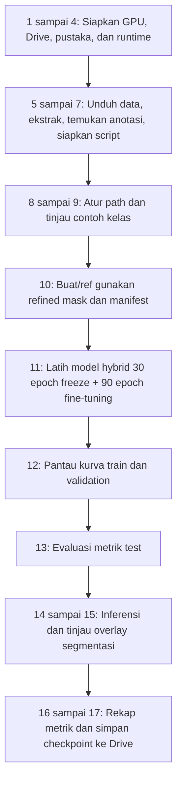
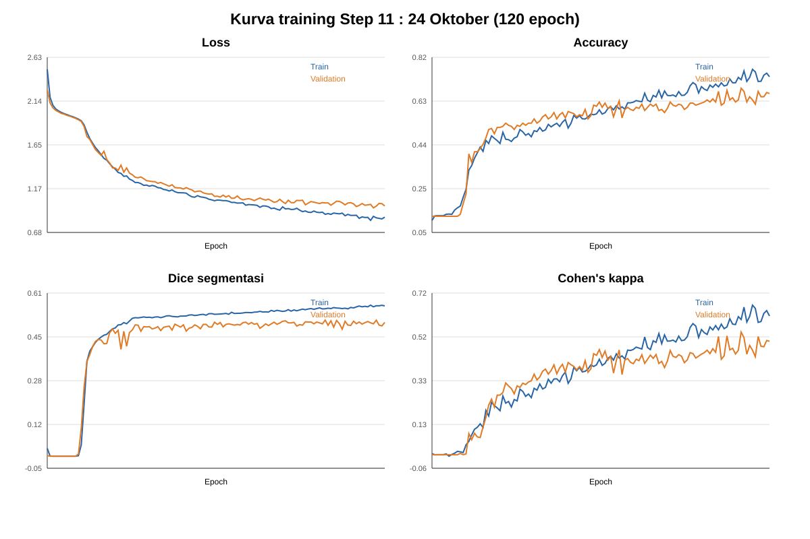
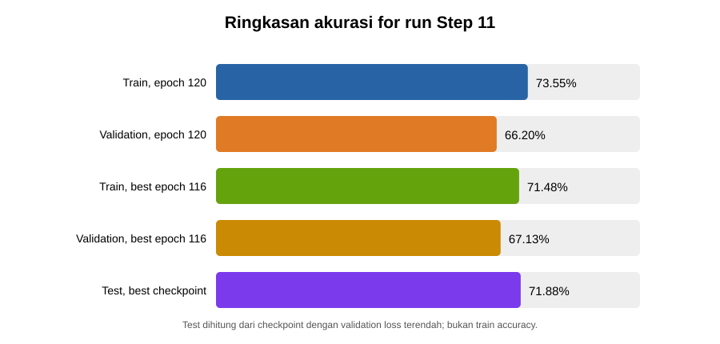

# Laporan Proses Penelitian :  24 Oktober 2026

## Fokus laporan

Laporan ini menjelaskan alur penelitian yang berkaitan dengan **run Step 11 pada 24 Oktober**, dari persiapan Colab dan dataset (Step 1 sampai 10), training (Step 11), sampai pemantauan, pengujian, inferensi, visualisasi, rekap, dan backup (Step 12 sampai 17). Bagian eksperimen tambahan Step 18 sampai 22 tidak dicampurkan karena merupakan jalur flowchart opsional yang ditambahkan terpisah.

Notebook menunjukkan urutan dan konfigurasi yang dimaksud. Untuk membedakan rencana dari kejadian yang tercatat, status tiap langkah dijelaskan berdasarkan kode notebook dan log hasil yang tersedia.

## Alur penelitian dari Step 1 sampai Step 17

### Persiapan lingkungan dan data

**Step 1 :  Menyiapkan GPU.** Sebelum menjalankan notebook, runtime Colab diatur ke GPU T4. Cell memeriksa versi PyTorch, ketersediaan CUDA, nama GPU, dan kapasitas VRAM. Jika CUDA tidak tersedia, notebook memberi peringatan karena training akan jauh lebih lambat. Log run 24 Oktober menyebut perangkat `cuda`.

**Step 2 :  Menghubungkan Google Drive.** `drive.mount('/content/drive')` menghubungkan Drive ke runtime. Dari sini notebook membaca `acne_scripts.zip` dan menyimpan output di `MyDrive/acne_project/output`. Ini menjaga hasil tetap ada setelah runtime Colab berhenti.

**Step 3 :  Memasang pustaka.** Notebook memasang PyTorch/torchvision untuk model, Pillow dan OpenCV untuk gambar/mask, NumPy untuk operasi array, pandas untuk manifest/CSV, Matplotlib untuk grafik, scikit-learn untuk metrik, tqdm untuk progress, dan gdown untuk unduh dari Drive.

**Step 4 :  Memuat pustaka Python.** Pustaka yang sudah terpasang diimpor ke sesi Python. Cell ini menyiapkan fungsi file/path, pembacaan gambar dan anotasi, tabel manifest, grafik, serta penggunaan GPU. Cell-cell berikutnya bergantung pada import ini.

**Step 5 :  Mengunduh ACNE04-v2.** `gdown` mengunduh isi folder Drive ke `/content/acne_images`. Dataset berisi arsip untuk gambar klasifikasi dan anotasi deteksi. File kerja lokal Colab menjadi sumber input preprocessing.

**Step 6 :  Mengekstrak dan mencari dataset.** Notebook mencari `.tar`, `.tar.gz`, atau `.tgz` di folder unduhan dan mengekstraknya. Setelah itu, kode memilih folder dengan foto JPG/JPEG terbanyak sebagai folder gambar. Anotasi dicari sebagai JSON yang namanya mengandung `annot`/`acne04`, atau sebagai folder XML VOC jika JSON tidak ditemukan. Jika gambar atau anotasi tidak ditemukan, proses dihentikan dengan error agar path dapat diperbaiki.

**Step 7 :  Menyiapkan script proyek.** Notebook mengekstrak `/MyDrive/acne_project/acne_scripts.zip` ke `/content/acne_project`, mencari folder yang berisi `refine_masks_color.py`, lalu memasukkan folder tersebut ke Python path. Script adalah program yang menjalankan pekerjaan inti penelitian; notebook mengatur urutan dan parameternya, sedangkan script mengimplementasikan pemrosesan gambar, model, training, dan inferensi.

Isi script utama yang dipakai dalam alur ini:

1. **`refine_masks_color.py` :  membuat input dan target segmentasi.** Script menerima folder foto dan anotasi JSON atau XML. Dari anotasi, script mengambil pusat dan radius lingkaran lesi (atau menghitung pusat/radius dari bounding box XML), lalu membuat circle mask. Foto dipotong sesuai crop yang ditentukan dan diubah ke kanvas persegi dengan `letterbox` atau `stretch`. Untuk refined mask, script membandingkan kemerahan Lab relatif terhadap kulit di luar lingkaran dan mendeteksi warna merah serta putih/kuning di HSV. Deteksi dibatasi ke circle mask, dirapikan dengan operasi morfologi, dan jika area deteksi terlalu sedikit script memakai circle mask sebagai fallback. Script menyimpan gambar input hasil resize, circle mask, refined mask, preview overlay, serta `refined_manifest.csv` berisi nama file, label, split, path gambar/mask, ukuran mask, dan penanda fallback. Dalam konfigurasi Step 10 notebook, mode `none` berarti gambar hanya di-resize/letterbox tanpa equalization warna, denoise, atau sharpening.

2. **`train_proposal_hybrid_resnet50_malds.py` :  membangun dan melatih model.** Script membaca manifest, membuka foto, mask, label, dan split; memvalidasi label/split; lalu membuat DataLoader train, validation, dan test. Train dapat diberi augmentasi berpasangan pada foto dan mask (rotasi dan flip; perubahan brightness/contrast hanya pada foto). Opsi class weighting menghitung bobot tiap kelas dari jumlah sampel train; opsi weighted sampler, bila flag-nya diberikan, mengambil sampel kelas minoritas lebih sering. Step 11 mengaktifkan class weighting tetapi tidak memberikan flag sampler. Berkas aktual `docs/24okt/test/metrics.json` menyimpan konfigurasi dan riwayat 120 epoch, termasuk train/validation accuracy.

   Modelnya menggunakan encoder ResNet-50 (dengan bobot ImageNet karena opsi pretrained aktif). Feature map encoder masuk ke Spatial Attention, lalu decoder dengan skip connection menghasilkan mask segmentasi. Cabang klasifikasi menggabungkan fitur global ResNet dan fitur morfologi yang dihitung dari mask prediksi melalui AMFM; hasilnya dipakai mengklasifikasikan empat tingkat severity. Training menghitung loss segmentasi BCE + Dice, loss klasifikasi KL dengan target MA-LDS dan class weights, serta loss morfologi MSE. Pada 30 epoch pertama parameter encoder dibekukan; pada 90 epoch selanjutnya encoder dibuka dan seluruh model di-fine-tune. Tiap epoch script mencatat metrik train dan validation, menyimpan `best_model.pt` saat validation loss membaik, serta menulis `last_checkpoint.pt` dan riwayat metrik agar training dapat dilanjutkan bila sesi terputus. Setelah epoch terakhir, checkpoint terbaik dievaluasi pada test kecuali opsi skip-test diaktifkan.

3. **`infer_testing_images.py` :  menjalankan model untuk tiap foto.** Script memilih baris manifest sesuai split (Step 14 memakai `test`), membuka checkpoint, membangun arsitektur sesuai jenis model/varian, dan menerapkan normalisasi input yang sesuai. Model menghasilkan logits kelas dan logits segmentasi; logits segmentasi diubah menjadi mask biner dengan threshold default 0,5. Script membandingkan prediksi dengan label/mask acuan jika tersedia, lalu menyimpan prediksi per foto ke CSV, ringkasan metrik, mask, dan overlay visualisasi.

4. **Script pendukung lain.** ZIP juga dapat memuat trainer baseline atau utilitas eksperimen. Keberadaan file dalam ZIP tidak berarti semuanya dipakai di Step 11: cell training menjalankan `train_proposal_hybrid_resnet50_malds.py`, sedangkan cell inferensi menunjuk `infer_testing_images.py`.

Pada Step 11 notebook memeriksa dukungan trainer untuk opsi seperti `--class-weighting`, `--variant`, dan `--skip-test-eval`, serta penyimpanan state optimizer. Jika script dari ZIP belum mendukungnya, cell mengambil versi terbaru `train_proposal_hybrid_resnet50_malds.py` dari branch `main` GitHub, memeriksa sintaks dan opsi yang diperlukan, lalu mengganti salinan di runtime Colab. Jadi script yang berjalan bisa berasal dari GitHub dan berbeda dari isi ZIP awal. Notebook tidak mencatat commit/hash script yang dipakai pada run 24 Oktober; versi persisnya tidak dapat diidentifikasi dari artefak lokal.

**Step 8 :  Mengatur dan memeriksa path.** Notebook menetapkan folder input foto/anotasi, output mask, manifest, folder training dan prediksi. Parameter umum diatur ke GPU bila tersedia, image size 320, batch size 16, 30 epoch fase pertama dan 90 epoch fase kedua. Cell validasi memastikan folder gambar, anotasi, dan script benar-benar ada; cell juga menghitung jumlah gambar per kelas agar masalah struktur dataset terlihat sebelum training.

**Step 9 :  Melihat contoh foto.** Kode mengumpulkan gambar JPG/JPEG, mencari nama file yang diawali `levle0`, `levle1`, `levle2`, dan `levle3`, lalu menampilkan satu contoh dari tiap kelas. Preview disimpan ke output sebagai `sample_images.png`. Ini pemeriksaan visual dasar untuk memastikan pembacaan foto dan pemetaan nama kelas masuk akal; ini bukan proses anotasi atau training.

**Step 10 :  Membuat refined mask dan manifest (preprocessing).** Script membaca anotasi JSON atau XML. Koordinat lingkaran lesi dari anotasi dipetakan ke kanvas 320 × 320. Gambar dipotong di tengah memakai rasio crop default 1.0, lalu di-resize dengan `letterbox`: skala dipertahankan dan ruang kosong diisi dengan pantulan tepi gambar agar foto tidak gepeng.

Untuk membentuk target segmentasi, script membuat **circle mask** dari lingkaran anotasi. Lalu script mendeteksi warna yang berpotensi menandai jerawat dari gambar asli: kemerahan relatif di ruang warna Lab dibanding kulit di luar lingkaran, ditambah rentang warna merah serta putih/kuning di HSV. Hasil deteksi dibatasi pada circle mask, kemudian dirapikan dengan operasi morfologi closing dan opening. Jika luas deteksi terlalu kecil (di bawah 2% area lingkaran), script memakai circle mask sebagai fallback. Jadi refined mask adalah target otomatis berbasis heuristik warna dan anotasi lingkaran, bukan mask yang dibuat manual satu per satu.

Mode `preprocessing-mode none` menyimpan gambar resize/letterbox tanpa equalization, denoise, atau sharpen. Mode `legacy` akan melakukan equalization per channel, median denoise, dan unsharp sharpening, tetapi bukan opsi yang diminta cell Step 10. Script menyimpan gambar hasil, circle mask, refined mask, overlay visualisasi, dan manifest. Manifest juga mencatat label yang diambil dari prefix nama file, ukuran, jumlah lingkaran, luas mask, fallback, serta split. Split ditetapkan secara stratified per kelas dengan rasio default 70% train, 15% validation, 15% test dan seed 42.

Cell preview setelah preprocessing menampilkan contoh tiga panel: foto asli, circle mask, dan refined mask. Ini tahap pemeriksaan visual terhadap target segmentasi sebelum training.

> Step 10 melewati proses pembuatan ulang jika `refined_manifest.csv` sudah ada. Karena itu, konfigurasi notebook menjelaskan pipeline yang dimaksud, tetapi belum membuktikan bahwa manifest yang benar-benar dipakai pada run 24 Oktober baru dibuat pada sesi tersebut dengan opsi itu.

### Training dan evaluasi

**Step 11 :  Melatih model.** Cell menjalankan Option A, yaitu Proposal Hybrid ResNet-50 + MA-LDS dengan class weighting. Konfigurasi yang tertulis:

- Data dari `refined_manifest.csv`; log hasil menunjukkan 1.017 train, 216 validation, dan 224 test.
- Model varian `proposed`: ResNet-50 pretrained, spatial attention, decoder segmentasi, AMFM, dan klasifikasi MA-LDS.
- Image size 320 × 320, batch 16, seed 42, CUDA bila tersedia.
- 120 epoch total: 30 epoch pertama encoder dibekukan, 90 epoch berikutnya encoder dibuka untuk fine-tuning.
- Class weighting `balanced` aktif. Weighted sampler **tidak aktif**, karena perintah Step 11 tidak menyertakan `--weighted-sampler`.
- Input memakai normalisasi ImageNet karena ResNet-50 pretrained digunakan.
- Output run diarahkan ke folder `2026-10-24_proposal_hybrid_letterbox_v2_balanced`.
- Cell mendukung resume jika checkpoint terakhir ada; konfigurasi aktual di `metrics.json` mencatat `resume: false`, jadi run ini dimulai tanpa melanjutkan checkpoint lama.

Model menghasilkan mask jerawat dan prediksi kelas severity secara bersamaan. Script menghitung loss segmentasi BCE + Dice, loss klasifikasi KL dengan target MA-LDS dan bobot kelas, serta loss morfologi. Pada data train digunakan augmentasi rotasi sampai 15°, flip horizontal probabilitas 0,5, dan perubahan brightness/contrast sampai 0,15. Validation dan test tidak diaugmentasi.

**Step 12 :  Memantau training.** Cell mengambil riwayat epoch dari `metrics.json`, lalu menggambar empat pasang kurva train/validation: loss, Dice segmentasi, accuracy klasifikasi, dan Cohen's kappa. Grafik disimpan sebagai `training_curves.png`. Kurva ini digunakan untuk melihat apakah metrik validation ikut membaik atau mulai menjauh dari train. Riwayat metrik Step 11 tersedia; gambar kurva hasil eksekusi cell ini tidak ada di folder lokal.

**Step 13 :  Membaca metrik test.** Setelah training selesai, cell membaca bagian `test_metrics` dan konfigurasi dari `metrics.json`. Yang ditampilkan meliputi accuracy dan kappa klasifikasi, Dice dan IoU segmentasi, total loss serta komponennya, best validation loss, jumlah epoch, batch size, dan image size. Ini ringkasan evaluasi test yang dihitung trainer.

**Step 14 :  Inferensi pada test set.** Script inferensi membaca hanya baris manifest dengan split `test`, memuat `best_model.pt`, dan menerapkan normalisasi input yang sesuai dengan checkpoint. Model memprediksi kelas severity dan mask segmentasi; threshold mask default 0,5 mengubah probabilitas menjadi mask biner. Script menyimpan CSV prediksi, ringkasan metrik, mask dan overlay per foto. Langkah ini menghasilkan artefak prediksi untuk inspeksi per gambar.

**Step 15 :  Melihat hasil segmentasi.** Notebook mencari folder overlay hasil inferensi, mengambil beberapa file PNG, lalu menampilkannya dalam grid. Tujuannya menilai secara visual apakah area prediksi bertumpuk dengan area mask acuan dan menemukan kasus yang perlu diperiksa. Preview ini bersifat kualitatif dan tidak menggantikan Dice/IoU.

**Step 16 :  Merekap eksperimen.** Notebook mencari file `experiment_results.csv` di bawah folder training. Jika ditemukan, file-file digabungkan; jika tidak, notebook membaca `metrics.json` tiap run. Rekap menampilkan nama run, encoder/epoch bila tersedia, test accuracy, kappa, Dice, dan IoU agar hasil antar-run dapat dilihat bersama.

**Step 17 :  Memastikan checkpoint tersimpan di Drive.** Notebook mencari file `best_model.pt` di bawah `/content`. Untuk setiap checkpoint, path relatif dipakai untuk membentuk tujuan di Drive; file hanya disalin jika tujuan belum ada. Cell ini merupakan pengamanan untuk checkpoint yang tersimpan lokal. Folder output Step 11 sendiri sudah ditetapkan di Drive, sehingga checkpoint run tersebut semestinya langsung berada di sana.

## Diagram alur

## Hasil Step 11 tanggal 24 Oktober

### Visualisasi hasil training

Kurva berikut dibuat dari riwayat 120 epoch pada `docs/24okt/test/metrics.json`. Panel menunjukkan perubahan loss, accuracy, Dice segmentasi, dan kappa pada train dan validation.

Grafik berikut membandingkan accuracy train dan validation pada epoch terakhir dengan accuracy train/validation pada epoch checkpoint terbaik, lalu memperlihatkan accuracy test dari checkpoint terpilih. Checkpoint terbaik dipilih berdasarkan validation loss terendah (epoch 116).

| Metrik pada test set | Hasil |
|---|---:|
| Jumlah foto test | 224 |
| Prediksi benar | 161 |
| Test accuracy | **71,88%** |
| Cohen's kappa | **0,5895** |
| Dice segmentasi | **0,4786** |
| IoU segmentasi | **0,3321** |

`metrics.json` mencatat metrik akhir pada epoch 120: **train accuracy 73,55%** dan **validation accuracy 66,20%**. Validation loss terbaik tercatat pada **epoch 116** (0,9540), dengan train accuracy **71,48%** dan validation accuracy **67,13%** pada epoch tersebut. Trainer memilih checkpoint berdasarkan validation loss terbaik, lalu evaluasi test menghasilkan **test accuracy 71,88%** (161 dari 224), kappa 0,5895, Dice 0,4786, dan IoU 0,3321. Jadi tiga angka accuracy berasal dari tahap/data yang berbeda dan tidak saling menggantikan.

Hasil test juga diringkas di [hasil_test.md](24okt/test/hasil_test.md); riwayat train dan validation per epoch terdapat di [metrics.json](24okt/test/metrics.json).

## Yang sudah dan belum dapat dipastikan

- **Tercatat:** konfigurasi Step 11, class weighting aktif, weighted sampler tidak aktif, split 1.017/216/224, training 120 epoch dua fase, dan metrik test.
- **Dari kode notebook:** preprocessing yang dimaksud adalah letterbox dan mode none; model menggunakan varian proposed dan mengaktifkan attention.
- **Tersedia pada artefak run:** `metrics.json` dengan konfigurasi, riwayat 120 epoch, train/validation metrics, dan metrik test.
- **Belum terverifikasi:** apakah manifest yang sudah ada benar-benar dibuat pada sesi itu dengan preprocessing yang diminta; gambar kurva yang dihasilkan cell Step 12 juga tidak tersedia lokal.
- Notebook memiliki jalur eksperimen tambahan Step 18 sampai 22 untuk audit filter, CV, ablation, dan final flowchart. Itu bukan bagian yang sama dengan training legacy Step 11 yang dibahas dalam laporan ini.

## Berkas rujukan

- Notebook: [acne_colab.ipynb](../acne_colab.ipynb), Step 1 sampai 17.
- Ringkasan hasil test Step 11: [hasil_test.md](24okt/test/hasil_test.md).
- Script trainer: [train_proposal_hybrid_resnet50_malds.py](../scripts/train_proposal_hybrid_resnet50_malds.py).

---

**Draf untuk diperiksa:** silakan koreksi urutan atau detail proses yang tidak sama dengan eksekusi aktual pada 24 Oktober.
